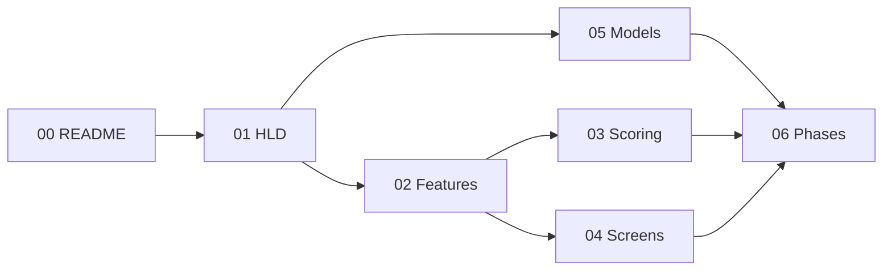

# IELTS + PTE Practice Portal — Product & Engineering Playbook

**Product type:** Own-infra practice web portal (Gurully-like feature parity for practice; not a white-label CRM).  
**Stack decision:** Django + Django Templates + Tailwind CSS (single repo, no SPA).  
**Exams in scope:** PTE Academic (+ PTE Core notes), IELTS Academic + General. DET / CELPIP = later.  
**Data:** Dummy fixtures only in early phases — content sourcing deferred.

This pack is for founders and engineers shipping a multi-tenant exam-practice product on owned infrastructure with **configurable approximation scoring** (never claim official Pearson/IELTS algorithms).

---

## How to read this pack

| Order | File | Audience | Purpose |
|------:|------|----------|---------|
| 1 | [00-README.md](./00-README.md) | Everyone | Index, stack, open questions |
| 2 | [01-high-level-design.md](./01-high-level-design.md) | Founder + tech lead | Vision, users, architecture, multi-tenant, stack |
| 3 | [02-feature-playbook.md](./02-feature-playbook.md) | PM + eng | Every major feature: flows, backend, edge cases |
| 4 | [03-scoring-algorithms.md](./03-scoring-algorithms.md) | Eng + scoring owners | Q-type scoring, rollups, AI scorer contracts |
| 5 | [04-low-level-screens.md](./04-low-level-screens.md) | Frontend/Django eng | URL → view → template → UI/motion |
| 6 | [05-data-models.md](./05-data-models.md) | Backend eng | Django model field sketches (dummy phase) |
| 7 | [06-phase-wise-implementation.md](./06-phase-wise-implementation.md) | Delivery | Phased plan + acceptance criteria |

**Suggested reading paths**

- **Founder / sales:** 00 → 01 → 02 (skim) → 06  
- **Backend lead:** 00 → 01 → 05 → 03 → 06  
- **Django/templates eng:** 00 → 04 → 02 → 05  
- **Scoring / AI vendor:** 03 + AI interface sections in 02  

---

## Stack decisions (locked for this playbook)

| Layer | Choice | Notes |
|-------|--------|-------|
| Backend | Django 5.x + Django Templates | No React/Vue SPA; HTMX optional later |
| CSS | Tailwind CSS | CDN for Phase 0–1 MVP; django-tailwind / Vite build from Phase 2+ |
| Motion | **Motion One** (`motion`) and/or **Alpine.js** + CSS | Framer Motion is React-only — do **not** pull React by default. Document React island only as a future escape hatch |
| Auth | django-allauth or built-in + custom roles | Email/password first; SSO later for institutes |
| DB | PostgreSQL | SQLite OK for local Phase 0 only |
| Media | Local / S3-compatible | Speaking audio blobs, listening clips, images |
| Async jobs | Celery + Redis (or Django-Q) | AI scoring, report generation |
| Multi-tenant | Schema-per-tenant **or** shared DB + `tenant_id` | Prefer shared DB + `Tenant` FK for MVP |
| Payments | Deferred | Stub plans; Stripe/Razorpay in later phase |
| Deploy | Own infra (Docker + nginx + Gunicorn) | No Gurully / third-party white-label CRM |

### Motion adaptation (explicit)

User ask: “framer and motion”.  

- **Default:** Motion One for page/section enter animations; Alpine.js for interactive UI (timers, tabs, audio recorder chrome); CSS `transition` / `@keyframes` for score reveals.  
- **Not default:** Framer Motion (requires React). Only if a future React island is approved for a complex canvas (e.g. reorder paragraph DnD). Prefer SortableJS / Alpine DnD without React.

---

## Product constraints (must not violate)

1. **Own infra, own scoring** — approximations + configurable rubrics; label practice scores clearly.  
2. **Dummy data first** — `factory_boy` / JSON fixtures; ignore real content sourcing.  
3. **Modes:** Full mock · Section-wise · Question-wise practice.  
4. **Roles:** Student · Institute Admin · Tutor (optional) · Super Admin.  
5. **AI speaking/writing:** pluggable service interface; early phases return deterministic fake scores.  
6. **No copyrighted exam content** in fixtures or docs — placeholders only.

---

## Pack map (mermaid)

---

## Open questions (track in backlog)

| ID | Question | Default assumption until decided |
|----|----------|-----------------------------------|
| OQ-1 | Schema-per-tenant vs shared DB + `tenant_id`? | Shared DB + `Tenant` FK |
| OQ-2 | Institute white-label branding depth? | Logo + primary colour CSS vars |
| OQ-3 | Speaking audio: WebM only vs convert to WAV server-side? | Record WebM; convert async for AI scorer |
| OQ-4 | PTE Core as separate exam product or flag on PTE Academic? | Separate `Exam.code` (`PTE_CORE`) sharing Q-types where identical |
| OQ-5 | CD-IELTS UI fidelity vs classic paper-style? | CD-IELTS-like (computer-delivered) as primary UI |
| OQ-6 | Prediction / “most repeated” tags — editorial process? | Metadata-only filter; content team owns tags later |
| OQ-7 | Tutor role in MVP? | Optional; Phase 5+ |
| OQ-8 | Offline / PWA? | Out of scope for v1 |
| OQ-9 | Exact AI vendor (speech-to-text + rubric LLM)? | Interface first; stub scorer until vendor chosen |
| OQ-10 | Day-based study plans vs date-based calendar? | Day-index plans (Day 1…N) stub; calendar later |

---

## Glossary (short)

| Term | Meaning |
|------|---------|
| Mock pack | Ordered set of questions simulating a full or section exam |
| Attempt | One run of a mock / section / question by a user |
| ScoreBreakdown | Per-item and rolled-up skill/band scores for an attempt |
| ScoringConfig | Tenant- or platform-level weights / rubrics (practice approximation) |
| Enabling skills | PTE sub-skills (e.g. Oral Fluency, Grammar) — approximated |
| Communicative skills | PTE Listening / Reading / Speaking / Writing rollups |
| CD-IELTS | Computer-delivered IELTS UI patterns |

---

## What this pack deliberately does **not** include

- Real Pearson / IELTS proprietary scoring formulas (unknown / licensed)  
- Copyrighted stems, audio transcripts, or official answer keys  
- Production Django project code (docs only — implement per Phase plan)  
- CRM / lead-gen / white-label reseller features beyond institute tenancy  

---

## Version

| Field | Value |
|-------|-------|
| Pack version | 1.0 |
| Date | 2026-09-17 |
| Status | Ready for Phase 0 engineering kickoff |
