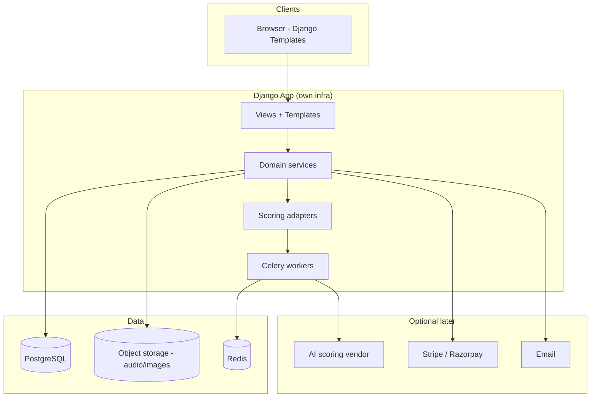
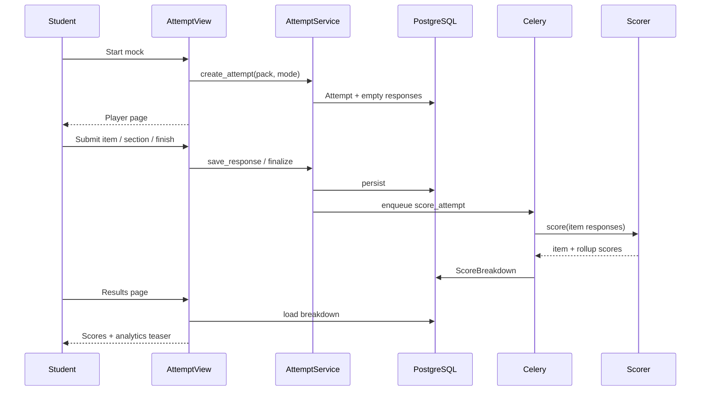

# 01 — High-Level Design

## 1. Vision

Build an **owned-infrastructure** web portal where students practise **PTE Academic** (and later PTE Core) and **IELTS Academic / General** via full mocks, section drills, and question-wise practice. Institutes get a tenant admin console. Scoring is **practice-grade approximation** with transparent, configurable rubrics — never marketed as official Pearson/IELTS scores.

**North star:** Single Django repo a small team (or client) can deploy, customise, and operate without SPA complexity or third-party practice CRM lock-in.

---

## 2. Users & roles

| Role | Primary goals | Key surfaces |
|------|---------------|--------------|
| **Student** | Take mocks, practise Q-types, see scores/analytics, follow day plans | Dashboard, catalogue, attempt player, results, analytics |
| **Institute Admin** | Manage org students, plans, branding, usage | Institute console, student list, assign packs |
| **Tutor** (optional) | Review attempts, leave feedback | Student attempts, comments |
| **Super Admin** | Tenants, global catalog, scoring configs, feature flags | Django admin + platform console |

### Role matrix (capability sketch)

| Capability | Student | Tutor | Inst. Admin | Super Admin |
|------------|:-------:|:-----:|:-----------:|:-----------:|
| Take practice / mock | ✓ | ✓* | — | ✓* |
| View own analytics | ✓ | ✓ | — | ✓ |
| View institute students | — | scoped | ✓ | ✓ |
| Assign packs / plans | — | limited | ✓ | ✓ |
| Manage tenant branding | — | — | ✓ | ✓ |
| Edit global Q bank | — | — | — | ✓ |
| Edit ScoringConfig | — | — | tenant override* | ✓ |
| Payments / plans catalog | — | — | buy seats | own catalog |

\*Impersonation / QA only where policy allows.

---

## 3. System context



**Boundary rules**

- Browser talks only to Django (SSR + form posts + small JSON endpoints for timers/audio upload).  
- AI scoring is behind an interface; Phase 0–3 use `DummyScorer`.  
- Payments are out of critical path until monetisation phase.

---

## 4. Django app architecture

Suggested Django apps (single project `portal`):

| App | Responsibility |
|-----|----------------|
| `tenancy` | Tenant/Org, branding, feature flags |
| `accounts` | UserProfile, roles, institute membership |
| `catalog` | Exam, QuestionType, Question, Asset, MockPack |
| `attempts` | Attempt, responses, timers, retake/reset |
| `scoring` | ScoreBreakdown, ScoringConfig, scorer adapters |
| `analytics` | Aggregations, skill charts, progress |
| `plans` | Plan, DayPlan, entitlements (stubs early) |
| `institute` | Admin console views for org |
| `billing` | Later: subscriptions, invoices |
| `core` | Shared mixins, middleware, utilities |

### Request path (typical attempt)



---

## 5. Multi-tenant sketch

**MVP recommendation:** Shared database, every row scoped by `tenant_id` (nullable for platform-global catalog questions that are cloned/linked per tenant).

```text
Tenant
  ├── branding (logo_url, primary_color, custom_domain?)
  ├── memberships (User ↔ role)
  ├── entitlements (Plan seats, feature flags)
  └── optional ScoringConfig overrides
```

**Isolation rules**

1. Middleware resolves tenant from subdomain / session / header.  
2. QuerySets default-filtered by tenant for institute data.  
3. Global question bank owned by Super Admin; tenants **link** packs (or soft-copy).  
4. Student belonging to Tenant A never sees Tenant B attempts.  
5. Super Admin uses explicit tenant switcher.

**Later upgrade path:** schema-per-tenant if compliance demands stronger isolation — design FKs so migration is painful but possible (avoid cross-tenant hard FKs to user PII elsewhere).

---

## 6. Dummy-data strategy

Ignore real content sourcing. Seed for demos and tests:

| Mechanism | Use |
|-----------|-----|
| `fixtures/*.json` | Static exams, Q-types, small mock packs |
| `factory_boy` | Bulk questions, attempts, score rows in tests |
| Management command `seed_demo` | One-shot local/staging bootstrap |
| Placeholder media | Short silent/beep WebM, 1×1 or stock-free SVG diagrams, lorem passages |

**Content rules**

- Stems like: “The climate of Region X is characterised by…”  
- Never paste real exam items or copyrighted audio.  
- Tag some items `prediction=true` randomly for filter demos.  
- Each Q-type needs ≥3 fixtures so section mocks feel real.

---

## 7. Tech stack (detail)

### Backend

- Python 3.12+, Django 5.x  
- PostgreSQL 16  
- Redis + Celery (or Django-Q2 for lighter ops)  
- django-storages / local MEDIA for MVP  
- WhiteNoise for static in simple deploys  

### Frontend (templates)

- Django Templates + template partials  
- Tailwind CSS (CDN → proper build)  
- Alpine.js for UI state (tabs, modals, recorder UX)  
- Motion One for enter/exit animations  
- HTMX **optional** for progressive enhancement (results partials) — not required Day 1  
- SortableJS or native DnD for reorder / drag-drop FIB  

### Audio

- Browser MediaRecorder API → upload blob to `Asset` / `Response.audio`  
- Playback via HTML5 `<audio>` for listening items  

### Observability (minimal)

- Structured logging  
- Sentry optional  
- Health endpoint for load balancer  

---

## 8. Exam products in scope

| Product | Detail level in this pack | Notes |
|---------|---------------------------|-------|
| PTE Academic | Full | Speaking/Writing/Reading/Listening Q-types |
| PTE Core | Notes / deltas | Similar engine; different item mix & scoring emphasis — flag as `Exam.code=PTE_CORE` |
| IELTS Academic | Full | L/R/W/S; Task 1 academic charts |
| IELTS General | Full | Same L/S; different Reading/Writing Task 1 |
| DET / CELPIP | Mention only | Future exam modules reusing attempt/scoring shells |

### PTE Core differences (engineering note)

- Reuse question-type engines where identical.  
- Separate mock pack templates and ScoringConfig profiles.  
- UI copy and timer defaults driven by `Exam` / `MockPack` config, not hardcoded Academic constants.

---

## 9. Practice modes

| Mode | Behaviour |
|------|-----------|
| **Full mock** | Full timed pack; section order fixed; limited navigation per exam rules (configurable) |
| **Section-wise** | One section (e.g. PTE Speaking, IELTS Reading); section timer |
| **Question-wise** | Single Q-type or single item; soft timer optional; instant or deferred score |

All modes create an `Attempt` with `mode` enum and share scoring pipeline.

---

## 10. Non-functional targets (MVP)

| Concern | Target |
|---------|--------|
| Concurrent students / tenant | Design for 200–500 active; scale vertically first |
| Audio upload | ≤ 5 min speaking clips; size cap configurable |
| Score latency (auto) | < 2s for deterministic items |
| Score latency (AI stub) | Async; UI shows “Scoring…” then poll/refresh |
| Accessibility | Keyboard for MCQ/FIB; captions later |
| Browser support | Latest Chrome/Edge/Firefox/Safari (MediaRecorder caveats documented) |

---

## 11. Security & compliance sketch

- AuthZ on every attempt/result by owner or institute role.  
- Signed URLs or auth-gated media for listening/speaking assets.  
- No official-score claims in UI copy (“Practice score — approximate”).  
- GDPR-ish: export/delete student data endpoints planned Phase 5+.  
- CSRF on all forms; rate-limit login and AI score enqueue.

---

## 12. Success metrics (product)

- Activation: first mock completed within 24h of signup  
- Retention: weekly returning practisers  
- Institute: seats utilised / assigned packs  
- Quality: scoring job success rate; student CSAT on feedback clarity  

---

## 13. Explicit non-goals (v1)

- Official test registration or score reporting to Pearson/IELTS  
- Mobile native apps  
- Live human proctoring  
- Full LMS (assignments beyond pack assign + day plans stub)  
