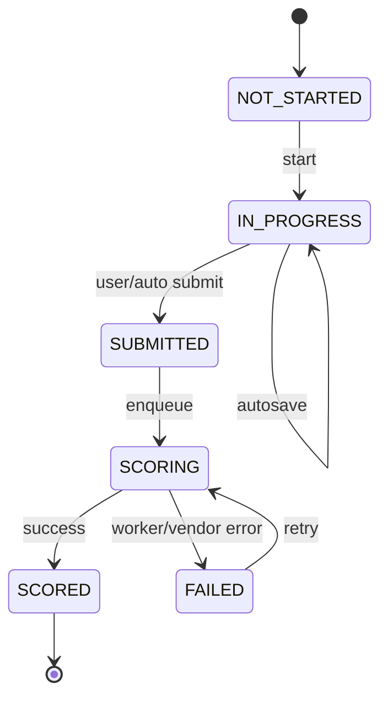

# 02 — Feature Playbook

Every major practice-product feature at Gurully-parity depth for **PTE + IELTS**. DET/CELPIP = phase later. Each feature: what · user flow · backend · edge cases.

---

## Feature index

1. Auth & profiles  
2. Multi-tenant institute membership  
3. Exam catalogue & filters  
4. Free mock / entitlement gate  
5. Full mock player  
6. Section-wise practice  
7. Question-wise practice  
8. Timers & navigation rules  
9. Listening media playback  
10. Speaking audio record/upload  
11. Writing editors  
12. Reading interaction engines (FIB, reorder, MCQ, TFNG…)  
13. Submit / auto-submit / disconnect recovery  
14. Scoring pipeline (auto + AI interface)  
15. Results & ScoreBreakdown UI  
16. Retake / reset  
17. Analytics dashboard  
18. Day-based study plans (stub)  
19. Prediction / tag filters (metadata)  
20. Templates & study aids (stubs)  
21. Institute admin console  
22. Tutor review (optional)  
23. Super Admin / platform ops  
24. Notifications (email stub)  
25. Payments (later stub)  
26. CD-IELTS UI conventions  
27. Accessibility & practice disclaimers  

---

## 1. Auth & profiles

**What:** Email/password signup/login; role-aware home redirect.

**User flow**

1. Student registers → verify email (optional MVP) → onboarding: choose primary exam (PTE / IELTS).  
2. Login → role router → Student dashboard / Institute console / Admin.  
3. Profile: name, target score/band, preferred exam, timezone (Asia/Kolkata default OK).

**Backend**

- `User` + `UserProfile` (role, tenant FK, target_score, onboarded_at).  
- Permissions via role flags or django-guardian only if needed later.  
- Session auth; optionally allauth.

**Edge cases**

- Institute-invited user already exists globally → attach membership, don’t duplicate User.  
- Super Admin must not accidentally land on student player as default.  
- Password reset tokens expire; rate-limit.

---

## 2. Multi-tenant institute membership

**What:** Students belong to zero or one primary institute (MVP); admins manage seats.

**User flow**

1. Inst Admin creates invite link / email.  
2. Student accepts → `Membership(role=student)`.  
3. Student sees institute branding (logo, colour).

**Backend**

- `Tenant`, `Membership`, middleware tenant context.  
- Branding CSS variables injected in base template.

**Edge cases**

- Student leaves institute → retain personal attempts; revoke pack licenses that were seat-based.  
- Custom domain later: host-header tenant resolve with fallback.

---

## 3. Exam catalogue & filters

**What:** Browse exams → packs → Q-types; filter by prediction tag, difficulty, section.

**User flow**

1. Catalogue home: PTE Academic | IELTS Academic | IELTS General cards.  
2. Drill into section or Q-type lists.  
3. Filters: `prediction`, `difficulty`, `practised/unpractised`, free vs locked.

**Backend**

- `Exam`, `QuestionType`, `MockPack`, `Question` with metadata JSON.  
- Queryset filters; annotate practised via Attempt joins.

**Edge cases**

- Empty filter results → helpful empty state + clear filters.  
- Locked packs show teaser count, not stems.

---

## 4. Free mock / entitlement gate

**What:** At least one free full mock per exam; paid/day-plan gates later.

**User flow**

1. New student sees “Free Mock” CTA.  
2. Start → if entitled, create Attempt; else paywall stub (“Plans coming soon” or Inst Admin assign).

**Backend**

- `Plan`, `Entitlement`, or simple `UserProfile.free_mocks_remaining`.  
- Gate in `AttemptService.start`.

**Edge cases**

- Double-click Start → idempotent create (client nonce / lock).  
- Institute override grants unlimited practice flag.

---

## 5. Full mock player

**What:** Timed, ordered mock matching exam section structure (practice approximation of pacing).

**User flow**

1. Instructions / mic check (PTE speaking) / headset check.  
2. Section progression with optional breaks (config).  
3. Per-item UI by Q-type.  
4. Review screen (if allowed) → Submit mock.  
5. Redirect to “Scoring…” then Results.

**Backend**

- `Attempt(mode=FULL_MOCK, pack=…)`.  
- `AttemptItem` rows pre-materialised from pack snapshot (freeze question versions).  
- State machine: `NOT_STARTED → IN_PROGRESS → SUBMITTED → SCORING → SCORED | FAILED`.

**Edge cases**

- Refresh mid-mock → restore from server state + remaining time.  
- Browser close → autosave last responses; resume policy configurable.  
- Pack edited after start → attempt uses snapshot, not live edits.

---

## 6. Section-wise practice

**What:** Practise one communicative section (e.g. PTE Listening, IELTS Writing).

**User flow:** Pick section → optional timer → complete → score section rollup.

**Backend:** `Attempt(mode=SECTION, section_code=…)`.

**Edge cases:** Writing/Speaking section may enqueue AI jobs only for those items; others sync-score.

---

## 7. Question-wise practice

**What:** Drill one Q-type or one item; fast feedback loop.

**User flow:** Choose type → next random/unseen item → answer → immediate auto-score when possible; AI types show pending.

**Backend:** `Attempt(mode=QUESTION)` with 1..n items; “practice queue” cursor in session or DB.

**Edge cases:** Exhausted pool → reshuffle with “seen” badge. Skip without scoring marks item skipped (0, unscored flag).

---

## 8. Timers & navigation rules

**What:** Per-item and/or per-section timers; navigation constraints per exam config.

**User flow**

- Visible countdown; warnings at 60s / 10s.  
- On expiry: autosubmit current response and advance (or lock section).

**Backend**

- Server stores `started_at`, `duration_sec`, `server_deadline`.  
- Client timer is UX; **server rejects** late submits beyond grace (e.g. +5s).

**Edge cases**

- Clock skew → trust server deadline.  
- Pause: only in practice modes if `ScoringConfig.allow_pause`; full mock typically no pause.  
- PTE-style auto-next after recording beep — driven by Q-type UI config.

---

## 9. Listening media playback

**What:** Play prompt audio; enforce play-once or limited replays per config.

**User flow:** Item loads → autoplay or Play button → optional progress bar → answer UI enabled per rules.

**Backend:** `Asset(kind=audio)` URL auth-gated; `Response.meta.play_count`.

**Edge cases**

- Buffering failure → retry UI; don’t consume play_count until `playing` event.  
- Seeking disabled when `allow_seek=false` (CD-IELTS-like).

---

## 10. Speaking audio record / upload

**What:** Mic permission → countdown → record → review (optional) → upload.

**User flow**

1. Mic check page stores level meter success.  
2. Item: Prepare time → beep → Record → Stop (or auto-stop at max).  
3. Upload progress → attached to response.

**Backend**

- POST multipart/chunked to `attempts:upload_audio`.  
- Store file; set `Response.audio_asset`.  
- Enqueue AI/dummy speaking scorer on finalize.

**Edge cases**

- Permission denied → blocking error with browser help.  
- Empty blob / too short → validation error, allow re-record if time left.  
- Safari codec differences → prefer audio/webm;opus with mp4 fallback; convert server-side later.  
- Max duration enforced client + server.

---

## 11. Writing editors

**What:** SWT, Essay, SST, IELTS Task1/Task2 textareas with word count.

**User flow:** Type response; live word count; copy-paste policy configurable (allow for practice).

**Backend:** `Response.text`; validate min/max words soft-warn, hard-limit optional.

**Edge cases:** Unicode/emoji; RTL; paste of huge text → truncate with notice. Autosave every N seconds.

---

## 12. Reading / Listening interaction engines

Shared interaction patterns (exam-agnostic engines):

| Engine | Used by (examples) |
|--------|--------------------|
| MCQ single | PTE R/L MCQ single; IELTS MCQ |
| MCQ multi | PTE R/L multi; IELTS multi |
| FIB dropdown | PTE Reading FIB dropdown |
| FIB drag-drop / bank | PTE Reading FIB drag; IELTS FIB |
| FIB type-in | PTE Listening FIB; IELTS forms |
| Reorder paragraphs | PTE Reading |
| Hotspot / HIW | PTE Highlight Incorrect Words |
| Matching | IELTS matching headings/info |
| TFNG / YNNG | IELTS Reading |
| Map/plan label | IELTS Listening maps |
| Select missing word | PTE Listening |

**User flow:** Standard select/drag/type → local state → submit on Next / autosave.

**Backend:** Normalise response JSON per engine schema (see scoring doc).

**Edge cases:** Drag accessibility keyboard fallback; double-submit; partial answers allowed (score partial credit where defined).

---

## 13. Submit / auto-submit / disconnect recovery

**What:** Reliable finalize under flaky networks.

**User flow:** Submit → confirm modal on full mock → progress UI while scoring.

**Backend**

- Idempotent finalize endpoint.  
- Autosave PATCH per item.  
- Resume token on Attempt.

**Edge cases**

- Finalize twice → return existing ScoreBreakdown.  
- Scoring worker crash → status FAILED + retry button (Super Admin / user limited retries).

---

## 14. Scoring pipeline (auto + AI interface)

**What:** Deterministic auto-score sync; AI speaking/writing async via interface.

**Contract (conceptual)**

```text
Scorer.score_item(question, response, config) -> ItemScore
Scorer.score_attempt(attempt, config) -> ScoreBreakdown
```

Implementations: `DeterministicScorer`, `DummyAIScorer`, later `VendorAIScorer`.

**User flow:** Auto items show marks immediately in question-wise mode; full mock waits for all jobs.

**Edge cases:** Partial AI failure → mark those items `score_status=error`, rest OK; overall flagged incomplete.

Detail: [03-scoring-algorithms.md](./03-scoring-algorithms.md).

---

## 15. Results & ScoreBreakdown UI

**What:** Overall score/bands, section scores, enabling skills (PTE), trait scores (IELTS W/S), per-item review.

**User flow:** Results summary → skills chart → item list (correct/incorrect/AI feedback) → retake CTA.

**Backend:** Read `ScoreBreakdown` JSON + relational item scores.

**Edge cases:** AI pending → skeleton UI. Disclaimer banner always visible.

---

## 16. Retake / reset

**What:** Retake same pack; or reset question-wise progress.

**User flow:** Retake → new Attempt (history preserved). Reset practice streak → clears “seen” cursor, not past attempts.

**Backend:** Never mutate scored Attempt; always new row. Soft-delete only for GDPR.

**Edge cases:** Entitlement consumes retake credit if plan says so; free mock retake policy configurable.

---

## 17. Analytics dashboard

**What:** Trends over attempts: overall, by section, by Q-type accuracy, time-on-task, weak skills.

**User flow:** Student analytics; Inst Admin aggregate (anonymised options).

**Backend:** Materialised aggregates table or ORM annotations; nightly Celery rollup optional.

**Edge cases:** Sparse data → empty charts with CTA to take mock. Don’t compare across exam products naively.

---

## 18. Day-based study plans (stub)

**What:** “Day 1: RA ×10 + Essay ×1” style plans.

**User flow:** Enrol plan → today checklist → mark done / auto-done when attempts satisfy.

**Backend:** `Plan`, `PlanDay`, `PlanEnrolment`, `PlanDayProgress` stubs.

**Edge cases:** Skip day → continue index or calendar catch-up (configurable). No payment required in stub.

---

## 19. Prediction / tag filters (metadata only)

**What:** Filter items tagged `prediction` / topics — **editorial metadata**, not a real predictor.

**User flow:** Toggle “Prediction” chip on catalogue.

**Backend:** `Question.tags` ArrayField/M2M; no ML.

**Edge cases:** UI copy must not promise exam appearance. “Practice focus tags” preferred wording.

---

## 20. Templates & study aids (stubs)

**What:** Essay templates, speaking tip cards, vocabulary lists — static MD/HTML stubs.

**User flow:** Study aids section → open template → copy structure (not answers).

**Backend:** `StudyAid` model or flat pages.

**Edge cases:** Don’t embed copyrighted prep-book content.

---

## 21. Institute admin console

**What:** Students, invites, assign packs, view aggregate usage, branding.

**User flow:** Admin login → Students → Invite → Assign free/paid pack → Usage chart.

**Backend:** `institute` app views; tenant-scoped querysets.

**Edge cases:** Seat limits; demote last admin prevention; export CSV.

---

## 22. Tutor review (optional)

**What:** Tutor opens student attempt, leaves text feedback on Writing/Speaking.

**User flow:** Queue of assigned students → attempt detail → comment threads.

**Backend:** `FeedbackNote` FK to Attempt/Item.

**Edge cases:** Tutor only sees assigned memberships; no cross-tenant.

---

## 23. Super Admin / platform ops

**What:** Tenants CRUD, global catalog, ScoringConfig editor, feature flags, job retries.

**User flow:** Platform console + Django admin for raw ops.

**Edge cases:** Dangerous scoring weight edits versioned (`ScoringConfig.version`).

---

## 24. Notifications (email stub)

**What:** Welcome, invite, scoring complete, weekly digest (later).

**Backend:** Console email backend in dev; templates in `templates/email/`.

---

## 25. Payments (later)

**What:** Stub Plan catalogue; checkout deferred (Stripe/Razorpay).

**Edge cases:** Don’t block practice engineering on payments; use entitlement flags.

---

## 26. CD-IELTS UI conventions

**What:** Computer-delivered IELTS look-and-feel notes for Listening/Reading/Writing.

**Notes for UI**

- Split pane: passage left / questions right for Reading where helpful.  
- Highlight tools (optional stub).  
- Listening: play controls limited; answers on same screen families.  
- Writing: dual task navigation with word counts.  
- Speaking: timer + part prompts (recording in practice mode even if official CD uses call).  

PTE UI: denser item chrome, status bar with item index, progressive disclosure of instructions.

---

## 27. Accessibility & practice disclaimers

**Always show:** “Scores are practice approximations, not official Pearson/IELTS results.”

A11y: focus rings, aria on timers, text alternatives for describe-image (short alt for UI; scoring uses image asset).

---

## Attempt lifecycle (canonical)



---

## DET / CELPIP (phase later)

Reuse: Attempt player shell, timers, analytics, tenancy.  
New: Q-type engines + ScoringConfig profiles + catalogue entries.  
Do not special-case in PTE/IELTS code paths — register via `QuestionType.engine`.
