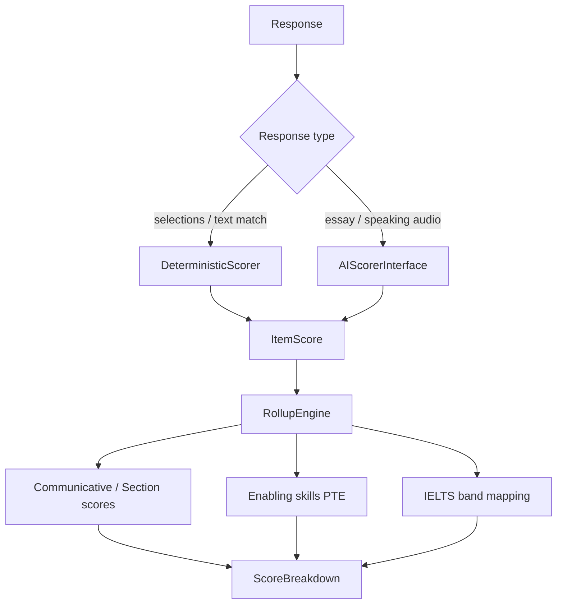

# 03 — Scoring Algorithms Playbook

**Critical disclaimer:** Official Pearson PTE and IELTS scoring algorithms are **proprietary**. This document defines **practice-platform approximations** with **transparent, configurable** weights stored in `ScoringConfig`. Never claim “official” scores in product UI or marketing.

All formulas below are **starting rubrics** for a practice portal. Tune via DB config per tenant/exam.

---

## 1. Scoring architecture



### Core types (conceptual)

```text
ItemScore:
  question_id, raw, max_raw, scaled_0_100, traits{}, flags{}, scorer="det|ai|dummy"

ScoreBreakdown:
  attempt_id
  overall          # PTE-like 10–90 or IELTS 0–9
  sections{}       # listening/reading/speaking/writing
  enabling{}       # PTE only (approx)
  items[]          # ItemScore list
  config_version
  disclaimer       # always set
```

### `ScoringConfig` (DB-driven)

| Key | Purpose |
|-----|---------|
| `item_weights[qtype]` | Relative weight into section |
| `section_weights` | Into overall |
| `partial_credit` | Booleans / schemes per engine |
| `ai_trait_weights` | Fluency, pronunciation, grammar… |
| `word_count_gates` | Min/max soft penalties |
| `band_tables` | IELTS raw→band maps (practice) |
| `pte_scale` | Clamp/round rules for 10–90 display |

---

## 2. AI scorer interface (pluggable)

```python
# Pseudocode contract — not production code


class AIScorerInterface:
    def score_speaking(self, audio_path: str, question: dict, config: dict) -> dict:
        """
        Returns:
          {
            "traits": {"content": 0-5, "oral_fluency": 0-5, "pronunciation": 0-5, ...},
            "transcript": "...",          # optional ASR
            "feedback": ["..."],
            "raw": float,
            "max_raw": float,
            "model": "dummy|vendor-x",
            "confidence": 0-1
          }
        """

    def score_writing(self, text: str, question: dict, config: dict) -> dict:
        """
        Returns traits e.g. content, form, grammar, vocabulary, development/structure…
        """


class DummyAIScorer(AIScorerInterface):
    def score_speaking(self, audio_path, question, config):
        # Deterministic fake: hash(audio_size + question_id) -> traits
        ...

    def score_writing(self, text, question, config):
        # Fake from word_count + simple heuristics + hash
        ...
```

Early phases: **always** `DummyAIScorer`. Swap vendor later without changing Attempt flow.

---

## 3. Shared deterministic engines

### 3.1 MCQ single

**Inputs:** `selected_option_id`  
**Score:** `raw = 1 if selected == key else 0`; `max_raw = 1`  
**Partial credit:** none  
**UI:** one selection; optional clear  

```text
item_score = 1 if response.choice == question.answer else 0
```

### 3.2 MCQ multi

**Inputs:** set of option ids  
**Practice schemes** (config `multi_mcq_scheme`):

| Scheme | Formula |
|--------|---------|
| `all_or_nothing` | 1 iff sets equal else 0 |
| `right_minus_wrong` | max(0, |correct ∩ sel| − |sel − correct|) / |correct| |
| `per_option` | (|correct ∩ sel| / |correct|) − penalty * |sel − correct| |

Default practice: `right_minus_wrong` scaled to `max_raw = len(correct)`.

### 3.3 FIB dropdown / drag-blank

**Inputs:** map `blank_id → selected_token`  
**Score:** sum of per-blank exact match (case-insensitive, strip)  
**Partial credit:** yes, per blank  
**max_raw:** number of blanks  

```text
raw = count(blank for blank in blanks if norm(resp[blank]) == norm(key[blank]))
```

### 3.4 FIB type-in (listening/reading)

Same as dropdown but accept **alias list** per blank (`answers: ["colour","color"]`).  
Optional Levenshtein: if `config.typo_distance >=1` and distance≤N → credit (practice only).

### 3.5 Reorder paragraphs

**Inputs:** ordered list of paragraph ids  
**Practice algorithms:**

1. **Exact:** 1 if order == key else 0  
2. **Adjacent pairs (recommended):**  

```text
pairs_correct = count adjacent pairs (i,i+1) that match key adjacency
max_raw = n - 1
raw = pairs_correct
```

### 3.6 Highlight Incorrect Words (HIW)

**Inputs:** set of clicked word indices  
**Score:**  

```text
# config scheme: right_minus_wrong
raw = max(0, |hit_incorrect| - |hit_correct_words|)
max_raw = |incorrect_words|
```

### 3.7 Select missing word / Highlight correct summary

Treat as MCQ single (one correct option).

### 3.8 Matching (IELTS headings, info, features)

**Inputs:** map `item → option`  
**Score:** per-pair exact; `raw = matches`, `max_raw = n`  
Some IELTS-style: headings use-once — validate UI enforces uniqueness.

### 3.9 TFNG / YNNG

MCQ single over `{True, False, Not Given}` or `{Yes, No, Not Given}`.

### 3.10 Form / note / table / flowchart completion

FIB type-in family with aliases; optional word-limit per blank (reject >N words → 0 for blank).

### 3.11 Map / plan / diagram labelling

Matching or FIB dropdown onto labels; same partial credit as matching.

---

## 4. PTE Academic — by question type

> Display overall often as **10–90** integer (practice). Item raw scores normalised then weighted.

### Rollup (practice)

```text
# Per communicative skill
section_score = weighted_mean(scaled_item_scores in section, weights=item_weights)

# Overall
overall = round_clamp(
  wL*Listening + wR*Reading + wS*Speaking + wW*Writing,
  min=10, max=90
)

# Enabling skills (approximation): map traits from items into buckets
# Oral Fluency, Pronunciation, Content, Grammar, Spelling, Vocabulary, Written Discourse…
enabling[skill] = round_clamp(mean(traits contributing), 10, 90)
```

**Note:** Real PTE uses proprietary IRT-like models. We use weighted means + trait averages.

---

### 4.1 Read Aloud (RA) — Speaking

| | |
|--|--|
| **Inputs** | Audio blob; prompt text known |
| **Time** | Prep ~30–40s; record up to ~30–40s (config per item) |
| **Scorer** | AI: content (text similarity to prompt via ASR), oral fluency, pronunciation |
| **Partial** | Trait-averaged |
| **Rollup** | Speaking + Reading enabling (content/read) practice split configurable |

```text
traits = AI.score_speaking(audio, {task: "RA", prompt_text})
raw = 0.4*content + 0.3*fluency + 0.3*pronunciation   # weights in ScoringConfig
```

Dummy: if duration in [min,max] and file_size>threshold → mid traits; else low.

---

### 4.2 Repeat Sentence (RS)

| | |
|--|--|
| **Inputs** | Audio blob; reference sentence |
| **Time** | Short prep; auto-record window |
| **Scorer** | AI: word accuracy vs reference (ASR), fluency, pronunciation |
| **Partial** | Word hit rate × fluency traits |

```text
wer = word_error_rate(asr, reference)
content = max(0, 1 - wer)
raw = 0.5*content + 0.25*fluency + 0.25*pronunciation
```

---

### 4.3 Describe Image (DI)

| | |
|--|--|
| **Inputs** | Audio; image asset + optional key points list (for practice AI) |
| **Time** | Prep ~25s; speak ~40s |
| **Scorer** | AI content (coverage of key points), fluency, pronunciation |
| **Partial** | Trait-based |

Dummy key points in question metadata — not shown to student.

---

### 4.4 Re-tell Lecture (RL)

| | |
|--|--|
| **Inputs** | Audio response; lecture audio (+ optional transcript for scorer only) |
| **Time** | Lecture play; prep; ~40s response |
| **Scorer** | AI content vs lecture summary points, fluency, pronunciation |

---

### 4.5 Answer Short Question (ASQ)

| | |
|--|--|
| **Inputs** | Audio (or text fallback in practice) |
| **Scorer** | Prefer AI ASR → match alias list **or** deterministic if typed practice mode |
| **Partial** | Usually all-or-nothing on meaning match |

```text
if any(alias in norm(asr) for alias in answers): raw=1 else 0
```

---

### 4.6 Respond to a Situation (RTS) — newer PTE item

| | |
|--|--|
| **Inputs** | Audio; situation prompt |
| **Scorer** | AI: appropriateness/content, fluency, pronunciation |
| **Partial** | Traits |

Treat like DI with situation rubric bullets in metadata.

---

### 4.7 Summarize Group Discussion (SGD) — newer PTE item

| | |
|--|--|
| **Inputs** | Audio; discussion audio |
| **Scorer** | AI content coverage of discussion points + fluency/pronunciation |

---

### 4.8 Summarize Written Text (SWT) — Writing

| | |
|--|--|
| **Inputs** | Text (one sentence summary practice rule: prefer 5–75 words config) |
| **Scorer** | AI: content, form (word count / one-sentence heuristic), grammar, vocab |
| **Form gate** | Outside word band → form trait penalty |

```text
form = 1 if min_w <= words <= max_w and sentence_count <= 2 else 0.3
raw = 0.5*content + 0.2*form + 0.2*grammar + 0.1*vocab
```

---

### 4.9 Write Essay (WE)

| | |
|--|--|
| **Inputs** | Text (~200–300 words practice band) |
| **Scorer** | AI traits: content, development/structure, form, grammar, vocab  
| **Time** | ~20 minutes typical practice |

```text
raw = sum(w_i * trait_i)  # config weights
```

---

### 4.10 Reading: FIB dropdown

Deterministic per-blank (§3.3). Contributes to Reading (+ Writing enabling spelling if typed — N/A for dropdown).

---

### 4.11 Reading: MCQ multiple answers

§3.2 scheme. Reading.

---

### 4.12 Reading: Reorder Paragraph

Adjacent-pairs default (§3.5). Reading.

---

### 4.13 Reading: FIB drag-and-drop

§3.3. Reading.

---

### 4.14 Reading: MCQ single answer

§3.1. Reading.

---

### 4.15 Listening: Summarize Spoken Text (SST)

| | |
|--|--|
| **Inputs** | Text (~50–70 words practice) |
| **Scorer** | AI content vs lecture points + form + grammar + vocab + spelling |
| **Rollup** | Listening + Writing |

---

### 4.16 Listening: MCQ multi / MCQ single

§3.2 / §3.1. Listening.

---

### 4.17 Listening: FIB (type-in)

§3.4 with spelling strictness config (`strict` vs `alias`). Listening (+ spelling enabling).

---

### 4.18 Highlight Correct Summary

MCQ single. Listening (+ Reading).

---

### 4.19 Select Missing Word

MCQ single. Listening.

---

### 4.20 Highlight Incorrect Words

§3.6. Listening (+ Reading).

---

### 4.21 Write from Dictation (WFD)

| | |
|--|--|
| **Inputs** | Text line |
| **Scorer** | Deterministic word credit |

```text
# Tokenize ref and hyp (lowercase, strip punct per config)
# Practice: credit each ref word found in order (LCS) or bag-of-words
scheme = config.wfd_scheme  # "lcs_ordered" | "bag"

if bag:
  raw = |intersection| ; max_raw = |ref_words|
if lcs_ordered:
  raw = LCS_length(ref, hyp) ; max_raw = |ref_words|
# Optional spelling: near-match distance 1 → half credit if enabled
```

**Partial credit:** yes — primary WFD practice signal.

---

### PTE communicative & enabling rollup (summary)

| Communicative | Typical contributing types (practice) |
|---------------|----------------------------------------|
| Speaking | RA, RS, DI, RL, ASQ, RTS, SGD |
| Writing | SWT, Essay, SST, WFD, FIB typed |
| Reading | All Reading + RA/HCS/HIW contributions per config |
| Listening | All Listening + RS/RL/ASQ… per config |

Enabling skills = trait buckets averaged → scaled 10–90. **Approximation only.**

---

### PTE Core differences (scoring notes)

- Same engines; different `ScoringConfig` profile and pack composition.  
- Some Academic-only items omitted; RTS/SGD availability depends on product year — drive from catalog flags.  
- Overall still practice-scaled; don’t mix Academic and Core norms on one chart without conversion note.

---

## 5. IELTS — by family

IELTS official band awards use certified examiners / proprietary listening-reading raw conversions. We use **practice band tables** in `ScoringConfig.band_tables`.

### 5.1 Overall band

```text
overall = round_ielts_band(mean(Listening, Reading, Writing, Speaking))
# round_ielts_band: practice mimic — .25→.0/.5/.5/.0 style table configurable
```

---

### 5.2 Listening (Academic & General same format families)

**Families:** form/note/table/flowchart/summary completion; MCQ; matching; map/plan/diagram labelling; sentence completion.

| | |
|--|--|
| **Inputs** | Per-engine responses |
| **Auto-score** | Deterministic (§3) |
| **Partial** | Per-question as per engine |
| **Time** | ~30 min (+ transfer if paper-style; CD-IELTS integrated) |
| **Rollup** | `raw_correct` → band via table (e.g. 39–40 → 9.0 practice row) |

```text
listening_raw = sum(item.raw for item in listening_items)  # usually 40 q practice pack
listening_band = band_table_L[listening_raw]
```

UI constraints: limited replay; no seek if `cd_mode`.

---

### 5.3 Reading Academic vs General

**Families:** TFNG, YNNG, matching headings, matching info/features/endings, MCQ, FIB (summary/note/table), identifying writer's views.

Same deterministic engines; **different** passages and band tables (`band_tables.reading_ac` vs `reading_gt`).

```text
reading_band = band_table_R[sum raw]
```

Time: 60 minutes typical; section-wise practice may shorten.

---

### 5.4 Writing Task 1 & Task 2

| | Task 1 | Task 2 |
|--|--------|--------|
| **Inputs** | Text | Text |
| **Time** | ~20 min | ~40 min |
| **Words** | ≥150 soft | ≥250 soft |
| **Scorer** | AI rubric traits | AI rubric traits |

**Practice traits (IELTS-like labels):**

- Task Achievement / Task Response  
- Coherence & Cohesion  
- Lexical Resource  
- Grammatical Range & Accuracy  

Each trait 0–9 in 0.5 steps (dummy scorer returns floats then snap).

```text
task_band = mean(traits)  # or weighted
writing_band = round_ielts_band(0.333*task1 + 0.667*task2)  # official-like weighting practice
```

Form penalties: severe under-length → cap Task Achievement.

**DummyAIScorer writing:**  

```text
base = clamp(words / target_words, 0.4, 1.0)
noise = hash(text) % 7 * 0.5
trait = clamp(4.0 + 3.0*base + (noise-1.5)*0.1, 0, 9)
```

---

### 5.5 Speaking Parts 1–3

| Part | Style | Time (practice) |
|------|-------|-----------------|
| 1 | Interview shorts | ~4–5 min |
| 2 | Long turn (cue card) | 1 min prep + 1–2 min speak |
| 3 | Discussion | ~4–5 min |

**Inputs:** Audio per part (or per question).  
**Scorer:** AI traits — Fluency & Coherence, Lexical Resource, Grammatical Range & Accuracy, Pronunciation (0–9).

```text
speaking_band = round_ielts_band(mean(all_part_traits))
```

UI: part navigator; recording required before Next if `require_audio`.

---

## 6. Scaling helpers (shared pseudocode)

```text
function scale_0_100(raw, max_raw):
  if max_raw <= 0: return 0
  return 100.0 * raw / max_raw

function pte_display(x):  # x in 0..100
  return clamp(round(10 + 0.8*x), 10, 90)   # EXAMPLE mapping — configure!

function snap_band(x):
  # Practice IELTS snap to {0,0.5,...,9}
  return round(x * 2) / 2

function weighted_mean(values, weights):
  return sum(v*w for v,w in zip(values,weights)) / sum(weights)
```

**Label in UI:** “Practice scale — not official.”

---

## 7. Time limits & UI constraints (scoring-relevant)

| Constraint | Effect on score |
|------------|-----------------|
| Empty response on timeout | raw=0, flag=`timeout_empty` |
| Partial response on timeout | score whatever was saved |
| Audio too short | speaking traits penalised / reject |
| Word count out of band | writing form/TA penalty |
| Play count exceeded | no score impact; UX block only |
| Late submit after grace | reject; keep last autosave |

---

## 8. Item → section → overall (checklist)

1. Score each item → `ItemScore`.  
2. Multiply by `item_weights[qtype]` (and optional difficulty factor).  
3. Aggregate to section / communicative skill.  
4. Map to PTE 10–90 or IELTS band via config tables.  
5. Compute enabling / traits averages.  
6. Persist `ScoreBreakdown` with `config_version` + disclaimer.  
7. Never backfill old attempts when config changes unless admin “re-score” tool runs explicitly.

---

## 9. What we will never claim

- Exact Pearson PTE automated scoring equivalence  
- Official IELTS examiner alignment  
- “Guaranteed exam score” from practice prediction tags  

Use copy: **“Approximate practice scores for training only.”**
