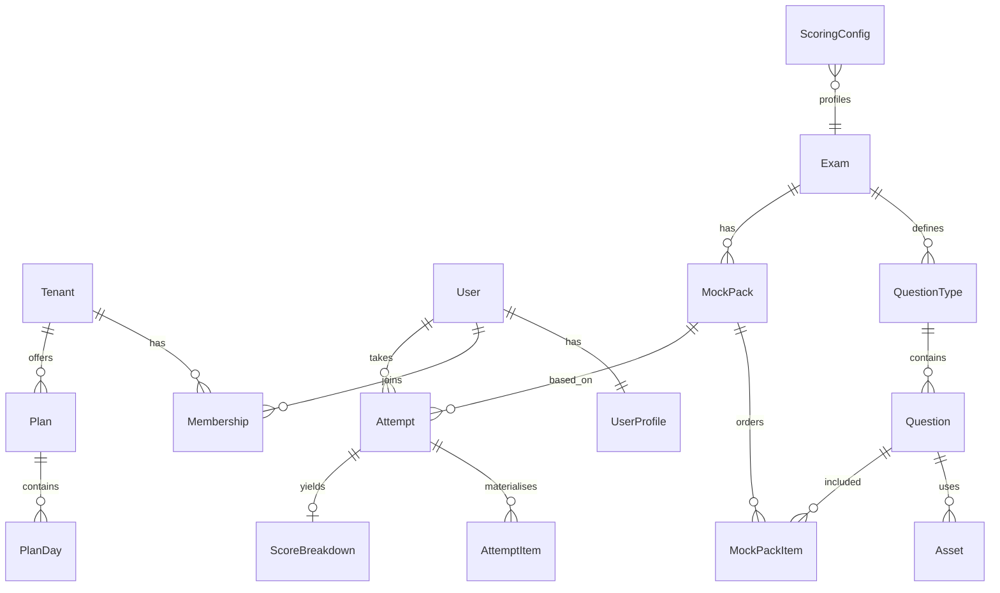

# 05 — Data Models (Django sketch, dummy phase)

Field-level sketches for the dummy/fixture phase. Not migrations — guidance for models.py. Use PostgreSQL types; SQLite locally OK early.

**Conventions**

- `created_at` / `updated_at` on all mutable models  
- Soft tenant scoping via `tenant` FK (nullable = global)  
- JSONField for flexible stems/keys/UI config  
- Never store official proprietary keys claiming authenticity  

---

## ER overview



---

## Tenant / Org

```text
class Tenant(Model):
    id: UUID / BigAuto
    slug: SlugField unique          # acme-institute
    name: CharField
    is_active: BooleanField default True
    logo: FileField/URLField null
    primary_color: CharField default "#0F766E"  # hex
    custom_domain: CharField null unique
    feature_flags: JSONField default=dict
      # {"unlimited_practice": false, "ai_scoring": true}
    seat_limit: PositiveInt null
    created_at, updated_at
```

```text
class Membership(Model):
    tenant: FK Tenant
    user: FK User
    role: CharField choices=[student, tutor, institute_admin]
    is_active: Boolean
    invited_at, joined_at
    unique_together (tenant, user)
```

---

## User (custom, `accounts.User`)

```text
class User(AbstractUser):
    firebase_uid: CharField(128) unique null  # Google identity via Firebase
    # email unique case-insensitively; password unusable for Firebase users
```

---

## UserProfile

```text
class UserProfile(Model):
    user: OneToOne User
    display_name: CharField
    role_primary: CharField  # student|tutor|institute_admin|super_admin
      # super_admin also is_staff; tenant roles via Membership
    primary_exam: FK Exam null
    target_score: DecimalField null  # PTE 10-90 or IELTS band
    timezone: CharField default "Asia/Kolkata"
    free_mocks_remaining: PositiveInt default 1
    onboarded_at: DateTime null
    avatar_url: URLField blank  # from Google profile
    meta: JSONField default=dict
```

---

## Exam & QuestionType

```text
class Exam(Model):
    code: CharField unique  # PTE_ACADEMIC, PTE_CORE, IELTS_AC, IELTS_GT
    name: CharField
    kind: CharField  # pte|ielts|other
    description: TextField blank
    is_active: Boolean
    default_config: JSONField
      # timers, navigation policy, ui_variant: "pte"|"cd_ielts"
```

```text
class QuestionType(Model):
    exam: FK Exam
    code: CharField  # RA, RS, FIB_DROP, TFNG, TASK2, ...
    name: CharField
    section: CharField  # speaking|writing|reading|listening|mixed
    engine: CharField  # mcq_single|fib_text|speaking_audio|writing_text|...
    default_time_sec: PositiveInt null
    ui_schema: JSONField  # instructions template keys
    scoring_schema: JSONField  # which scorer, partial scheme name
    unique_together (exam, code)
```

---

## Question & Asset

```text
class Question(Model):
    id: UUID recommended
    exam: FK Exam
    question_type: FK QuestionType
    tenant: FK Tenant null  # null = global bank
    title: CharField  # internal only
    difficulty: PositiveSmallInt default 3  # 1-5
    tags: ArrayField(CharField) / M2M Tag
      # e.g. ["prediction", "environment"]
    is_prediction: Boolean default False  # denormalised filter helper
    stem: JSONField
      # {"text":"The climate of…", "options":[...], "blanks":[...],
      #  "paragraphs":[...], "image_asset_id":..., "audio_asset_id":...,
      #  "word_bank":[...], "map_hotspots":[...]}
    answer_key: JSONField
      # normalised for DeterministicScorer; aliases[]; never shown in list API
    scorer_meta: JSONField
      # {"key_points":[...], "reference_text":"...", "min_words":5, "max_words":75}
    is_active: Boolean
    version: PositiveInt default 1
    created_at, updated_at
```

```text
class Asset(Model):
    id: UUID
    tenant: FK null
    kind: CharField  # audio|image|pdf|other
    file: FileField
    content_type: CharField
    duration_ms: PositiveInt null  # audio
    meta: JSONField  # waveform stub, alt text
    created_at
```

**Security:** Serve via auth-checked view or signed URL; do not expose answer audio transcripts in client JSON for listening keys.

---

## MockPack

```text
class MockPack(Model):
    exam: FK Exam
    tenant: FK null
    slug: SlugField
    title: CharField
    mode_default: CharField  # full_mock
    is_free: Boolean default False
    duration_sec: PositiveInt null  # overall cap optional
    structure: JSONField
      # [{"section":"speaking","title":"Speaking","time_sec":...}, ...]
    navigation_policy: JSONField
      # {"allow_back": false, "allow_pause": false, "reveal_on_practice": true}
    is_active: Boolean
```

```text
class MockPackItem(Model):
    pack: FK MockPack
    question: FK Question
    order: PositiveInt
    section_code: CharField
    time_override_sec: PositiveInt null
    unique_together (pack, order)
```

Snapshot note: when Attempt starts, copy pack item list into AttemptItem so edits don’t mutate in-flight mocks.

---

## Attempt & responses

```text
class Attempt(Model):
    id: UUID
    user: FK User
    tenant: FK null  # denormalised from membership
    exam: FK Exam
    pack: FK MockPack null  # null for ad-hoc question-wise
    mode: CharField  # full_mock|section|question
    section_code: CharField null
    status: CharField
      # not_started|in_progress|submitted|scoring|scored|failed
    started_at, submitted_at, scored_at
    server_deadline_at: DateTime null
    duration_sec: PositiveInt null
    config_snapshot: JSONField  # navigation + scoring config version
    meta: JSONField  # resume cursor, play counts summary
```

```text
class AttemptItem(Model):
    attempt: FK Attempt
    order: PositiveInt
    question: FK Question
    question_version: PositiveInt
    section_code: CharField
    stem_snapshot: JSONField  # stem without secrets if needed
    answer_key_snapshot: JSONField  # server-only; exclude from serializer
    time_limit_sec: PositiveInt null
    started_at, submitted_at
    response: JSONField null
      # engine-specific: {"choice":...}|{"choices":[]}|{"blanks":{}}|
      # {"order":[]}|{"text":"..."}|{"audio_asset_id":...}|{"matches":{}}
    response_flags: JSONField  # timeout_empty, play_count, word_count
    score_status: CharField  # pending|scored|error|skipped
    item_score: JSONField null  # ItemScore blob
    unique_together (attempt, order)
```

---

## ScoreBreakdown

```text
class ScoreBreakdown(Model):
    attempt: OneToOne Attempt
    overall: DecimalField null
    scale: CharField  # pte_10_90|ielts_band
    sections: JSONField
      # {"listening": 72, "reading": 68, ...} or bands
    enabling: JSONField null  # PTE approx
    traits: JSONField null  # IELTS W/S traits aggregate
    items_summary: JSONField  # optional denorm list
    config_version: CharField
    scorer_versions: JSONField  # {"dummy_ai":"1.0","det":"1.0"}
    disclaimer: TextField
    raw_worker_log: JSONField null  # debug; admin only
    created_at
```

---

## ScoringConfig

```text
class ScoringConfig(Model):
    exam: FK Exam
    tenant: FK null  # null = platform default
    version: CharField  # "2026.09.1"
    is_active: Boolean
    weights: JSONField
      # item_weights, section_weights, ai_trait_weights, multi_mcq_scheme,
      # wfd_scheme, band_tables, pte_scale, word_count_gates, partial_credit
    notes: TextField  # "Practice approximation"
    created_at
    # unique active per (exam, tenant) enforced in service layer
```

---

## Plan (stub)

```text
class Plan(Model):
    tenant: FK null  # null = platform catalogue
    code: CharField
    name: CharField
    exam: FK Exam null
    days_count: PositiveInt
    price_stub: DecimalField null  # display only early
    entitlements: JSONField
      # {"mocks": 5, "ai_scoring": true, "unlimited_q_practice": true}
    is_active: Boolean
```

```text
class PlanDay(Model):
    plan: FK Plan
    day_index: PositiveInt  # 1..N
    title: CharField
    tasks: JSONField
      # [{"qtype":"RA","count":10},{"pack_id":...}]
```

```text
class PlanEnrolment(Model):
    user: FK User
    plan: FK Plan
    started_on: Date  # day-index anchor
    status: CharField  # active|completed|cancelled
```

```text
class PlanDayProgress(Model):
    enrolment: FK PlanEnrolment
    day_index: PositiveInt
    completed_tasks: JSONField
    is_done: Boolean
```

---

## Entitlement / gating (minimal)

```text
class Entitlement(Model):
    user: FK User null
    tenant: FK null
    key: CharField  # free_mock_pte|pack:123|unlimited
    value: JSONField
    expires_at: DateTime null
    source: CharField  # signup|institute|purchase_stub
```

---

## Study aids & feedback (stubs)

```text
class StudyAid(Model):
    exam: FK null
    slug: SlugField
    title: CharField
    body_html: TextField  # sanitised
    tags: ArrayField
    is_active: Boolean
```

```text
class FeedbackNote(Model):
    attempt: FK Attempt
    attempt_item: FK AttemptItem null
    author: FK User  # tutor
    body: TextField
    created_at
```

---

## Tag (optional normalised)

```text
class Tag(Model):
    slug: SlugField unique
    label: CharField
    kind: CharField  # topic|prediction|skill
```

---

## Dummy fixture checklist

| Model | Min seed rows |
|-------|---------------|
| Exam | 4 (PTE_AC, PTE_CORE, IELTS_AC, IELTS_GT) |
| QuestionType | all PTE + IELTS families listed in scoring doc |
| Question | ≥3 per major type |
| Asset | few beep audios + placeholder images |
| MockPack | 1 free full mock per exam + 1 section pack |
| Tenant | 1 demo institute |
| Users | super, inst admin, 2 students |
| ScoringConfig | 1 active per exam |
| Plan | 1 day-plan stub (7 days) |

Factories: `factory_boy` for Attempt + AttemptItem + ScoreBreakdown in tests.

---

## Indexes (recommended)

- `Attempt(user, status, started_at desc)`  
- `Question(exam, question_type, is_active, is_prediction)`  
- `Membership(tenant, role)`  
- `MockPackItem(pack, order)`  

---

## Secrets & serialization rules

| Field | Client |
|-------|--------|
| `answer_key` / `answer_key_snapshot` | Never in player JSON |
| `scorer_meta.key_points` | Never to student before score; optional in review if policy allows |
| Listening transcripts for keys | Server only |
| `ScoreBreakdown.raw_worker_log` | Super Admin only |
