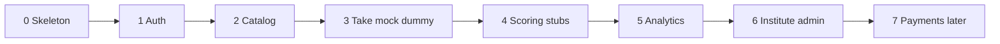

# 06 — Phase-Wise Implementation Plan

Docs-only kickoff plan. **Do not** treat payments or real AI vendors as blockers for practice UX. Each phase: goals · deliverables · acceptance criteria · exits.

---

## Phase map

---

## Phase 0 — Skeleton

**Goals:** Runnable Django project, Tailwind wiring, base layout, health check, empty apps.

**Deliverables**

- Django project `portal` + apps: `core`, `accounts`, `tenancy`, `catalog`, `attempts`, `scoring`, `analytics`, `plans`, `institute`  
- `base.html` + Tailwind (CDN acceptable)  
- Motion One + Alpine.js included in base  
- Docker Compose optional: web + postgres + redis  
- `manage.py check` green  
- Disclaimer component present  

**Acceptance**

- [ ] `GET /` returns landing with exam placeholder cards  
- [ ] Static Tailwind classes render  
- [ ] Alpine + Motion smoke (button fade) works in Chrome  
- [ ] Settings split base/dev/prod stubs  
- [ ] README in repo points to this playbook path  

**Exit:** Dev can runserver and see branded shell.

---

## Phase 1 — Auth & profiles

**Goals:** Register/login/logout; UserProfile; role redirect; onboarding.

**Deliverables**

- Auth views/templates  
- `UserProfile` model + admin  
- Onboarding (primary exam, target)  
- Permissions mixins `StudentRequired`, `InstituteAdminRequired`, `SuperAdminRequired`  

**Acceptance**

- [ ] New user registers → onboarding → dashboard  
- [ ] Logout clears session  
- [ ] Password reset path works (console email OK)  
- [ ] Superuser flagged `role_primary=super_admin` reaches `/platform/` (can be stub page)  
- [ ] Unauthorized access to `/org/` → 403  

**Exit:** Role-aware navigation stable.

---

## Phase 2 — Catalogue (dummy data)

**Goals:** Exams, Q-types, questions, assets, mock packs seeded; browse UI.

**Deliverables**

- Models from [05-data-models.md](./05-data-models.md) for catalog  
- `seed_demo` management command + JSON fixtures  
- Catalogue screens (exam list/detail, qtype list, mock list/detail)  
- Prediction filter chip (metadata)  
- Locked state UI for non-entitled packs (hardcode free flag)  

**Acceptance**

- [ ] ≥1 free mock pack per PTE Academic & IELTS Academic  
- [ ] ≥3 questions for each major engine family used in Phase 3  
- [ ] Filters update list without 500s  
- [ ] No copyrighted stems — placeholders only  
- [ ] Answer keys never appear in HTML source of catalogue pages  

**Exit:** Can click through to Start on a free mock (Start may 501 until Phase 3).

---

## Phase 3 — Take mock with dummy responses

**Goals:** Attempt lifecycle without real scoring: start, play engines, autosave, submit, resume.

**Deliverables**

- `Attempt`, `AttemptItem` + snapshotting  
- Player shell + item partials for: MCQ, FIB text/dropdown, reorder, writing textarea, speaking recorder, listening player  
- Timers with server deadline  
- Autosave + audio upload endpoints  
- Mic check page  
- Submit → status SUBMITTED (scoring page can no-op)  

**Acceptance**

- [ ] Full mock completable with dummy pack end-to-end  
- [ ] Refresh mid-attempt restores responses + timer within 2s skew  
- [ ] Speaking upload stores playable file  
- [ ] Listening play_count increments; seek hidden when configured  
- [ ] Double finalize is idempotent  
- [ ] Section-wise & question-wise modes create attempts with correct `mode`  

**Exit:** Attempts persist; student sees “submitted” confirmation.

---

## Phase 4 — Scoring stubs

**Goals:** Deterministic auto-score + DummyAIScorer; ScoreBreakdown; results UI.

**Deliverables**

- `ScoringConfig` seeded per exam  
- `DeterministicScorer` for selection/FIB/reorder/WFD/HIW/TFNG/matching  
- `DummyAIScorer` for speaking/writing  
- Celery/Django-Q task `score_attempt` (sync fallback flag for dev)  
- Results + review item pages with disclaimer  
- Re-score admin action (optional)  

**Acceptance**

- [ ] MCQ/FIB/reorder scores match documented formulas on fixture keys  
- [ ] WFD partial credit returns mid scores for partial typing  
- [ ] Writing/speaking leave `pending` then resolve via dummy traits  
- [ ] PTE attempt shows communicative sections + enabling JSON  
- [ ] IELTS attempt shows band-style overall + writing/speaking traits  
- [ ] UI never says “official”  
- [ ] Failed worker sets Attempt FAILED + retry works  

**Exit:** Scored results are demo-ready for founders.

---

## Phase 5 — Analytics

**Goals:** Student progress views; basic aggregates.

**Deliverables**

- Analytics queries: attempts over time, accuracy by Q-type, section averages  
- Dashboard widgets wired to real data  
- Chart.js charts  
- Empty states  

**Acceptance**

- [ ] After ≥3 scored attempts, charts render non-zero series  
- [ ] Filter by exam works  
- [ ] No cross-user data leakage (test with two students)  

**Exit:** Students see meaningful practice trends.

---

## Phase 6 — Institute admin

**Goals:** Multi-tenant membership, invites, branding, assign packs, student list.

**Deliverables**

- `Tenant`, `Membership`, middleware tenant resolve (subdomain or session)  
- Institute console screens  
- Invite create/accept  
- Branding colour/logo → CSS vars  
- Assign entitlement / pack access  
- Tutor optional: view-only attempt list + FeedbackNote  

**Acceptance**

- [ ] Inst admin sees only own students  
- [ ] Invited student joins tenant and sees branding  
- [ ] Seat_limit enforced when set  
- [ ] Super Admin can switch/list tenants  
- [ ] Student from Tenant A cannot open Tenant B attempt URLs (404/403)  

**Exit:** Demo institute walkthrough possible.

---

## Phase 7 — Payments later (+ polish)

**Goals:** Monetisation stubs → real provider; day plans; study aids; hardening.

**Deliverables**

- Plan catalogue + enrolment day-index progress  
- Study aids pages  
- Stripe or Razorpay integration behind feature flag  
- Entitlement grants on successful payment  
- Rate limits, Sentry, backup docs  
- Accessibility pass on player  
- PTE Core pack + ScoringConfig profile  
- IELTS General reading/writing Task1 variants  

**Acceptance**

- [ ] Paid plan grant flips entitlement without manual DB edit  
- [ ] Day plan checklist auto-completes when tasks satisfied  
- [ ] Webhook idempotency covered by tests  
- [ ] Load smoke: 50 concurrent autosaves no data loss  

**Exit:** Soft launch candidate.

---

## Cross-phase engineering standards

| Standard | Rule |
|----------|------|
| Tests | Model + scoring unit tests from Phase 4; attempt API tests from Phase 3 |
| Fixtures | `seed_demo` must be idempotent |
| Secrets | `.env` for Django secret, DB, redis; never commit |
| Copy | British/Indian English OK; practice disclaimer mandatory |
| Motion | Motion One / Alpine only unless React island explicitly approved |
| Scoring | All weights in `ScoringConfig`; versioned |

---

## Suggested team sequencing (small team)

| Week | Focus |
|------|-------|
| 1 | Phase 0–1 |
| 2 | Phase 2 + engines scaffold |
| 3–4 | Phase 3 player completeness |
| 5 | Phase 4 scoring |
| 6 | Phase 5 analytics |
| 7–8 | Phase 6 institute |
| 9+ | Phase 7 payments & polish |

---

## Definition of done (product MVP)

1. Student completes free PTE + IELTS academic mocks with approximate scores.  
2. Question-wise practice works for major Q-types.  
3. Institute can invite students and apply branding.  
4. Dummy AI scorer swappable via interface.  
5. No official-score claims anywhere in UI.  
6. Single Django repo deployable on own infra.

---

## Out of scope until explicitly reopened

- Real content licensing / publisher feeds  
- DET / CELPIP full engines  
- Native mobile apps  
- Live human proctoring  
- Gurully-style CRM / reseller marketplace  
