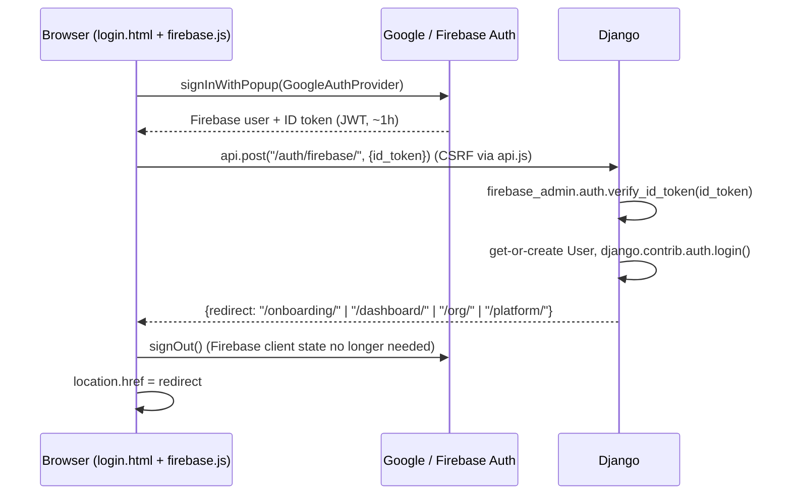

# 07 — Authentication: Google sign-in via Firebase

> **Decision (supersedes email/password in 00–06):** students and institute users sign in **only with Google, through Firebase Authentication**. There are no passwords, no password reset, and no separate register form. Django stays the source of truth for users, roles, tenants and sessions; Firebase only proves *who* the person is.

---

## 1. Why this shape

| Concern | Choice |
|---------|--------|
| Identity provider | Firebase Auth, Google provider only (more providers can be enabled later in the console) |
| Session | Django session cookie (server-rendered templates, CSRF, `request.user` keep working everywhere) |
| Token use | Firebase ID token is exchanged **once** at login and discarded; it is not sent on every request |
| Roles / tenancy | Unchanged: `UserProfile.role_primary` + `tenancy.Membership` |
| Django admin `/admin/` | Keeps Django password login for superusers (break-glass access if Firebase is down) |

---

## 2. Login flow



1. `/accounts/login/` renders a single **Continue with Google** button (Tailwind card, Motion scale-in).
2. `static/js/firebase.js` initialises the Firebase Web SDK from `FIREBASE_WEB_CONFIG` (rendered with `json_script`), runs `signInWithPopup`; falls back to `signInWithRedirect` when the popup is blocked.
3. The ID token is POSTed through the central client (`api.js`), so CSRF and error handling stay in one place.
4. Django verifies and logs the user in; the response carries the role-aware redirect.
5. `/accounts/register/` redirects to `/accounts/login/` — first Google sign-in creates the account.

**Logout:** `POST /api/auth/logout/` → `django.contrib.auth.logout()` (clears the session), then client `signOut()` defensively and redirect to `/`.

---

## 3. Server-side verification (`accounts/firebase.py`)

```python
claims = firebase_admin.auth.verify_id_token(id_token, clock_skew_seconds=10)
```

Reject (HTTP 401, JSON `{error}`) unless **all** hold:

- signature, `aud == FIREBASE_PROJECT_ID`, `iss`, `exp` valid (done by `verify_id_token`)
- `claims["firebase"]["sign_in_provider"] == "google.com"`
- `claims["email_verified"] is True`
- `auth_time` within the last 5 minutes (a stolen old token can't mint a session)
- optional `FIREBASE_ALLOWED_EMAIL_DOMAINS` allow-list (empty = any Google account)

`verify_id_token` only needs the project ID and Google's public certs, so **no service-account key is required** for login. `FIREBASE_SERVICE_ACCOUNT_JSON` is optional and only needed later for revocation checks / disabling users from Django.

---

## 4. Account mapping

```text
uid = claims["uid"]; email = claims["email"].lower()

user = User.objects.filter(firebase_uid=uid).first()
    or User.objects.filter(email__iexact=email, firebase_uid=None).first()   # pre-created / invited → link
    or User.objects.create(username=uid, email=email, firebase_uid=uid)      # first sign-in
user.set_unusable_password()   # only for users created via Firebase
profile.display_name ||= claims["name"];  profile.avatar_url = claims.get("picture", "")
user.last_login updated by login()
```

- An institute-invited email that already exists is **linked**, never duplicated (playbook 02 edge case).
- Inactive users (`is_active=False`) are refused even with a valid token.
- Superusers created with `createsuperuser` can also link Google by signing in with the same email.

### Role router (after login)

| Condition | Redirect |
|-----------|----------|
| `role_primary == super_admin` | `/platform/` |
| active `Membership` with role `institute_admin` | `/org/` |
| `profile.onboarded_at is None` | `/onboarding/` |
| otherwise | `/dashboard/` |

A `next` query param is honoured only if `url_has_allowed_host_and_scheme`.

---

## 5. Model changes

```text
accounts.User
    firebase_uid: CharField(128) unique null blank, db_index   # Firebase "uid"
    email: case-insensitive unique constraint (Lower("email")) where email != ""

accounts.UserProfile
    avatar_url: URLField blank   # Google photo
```

No password-reset tables or tokens are used.

---

## 6. Endpoints

| Method | Path | Name | Notes |
|--------|------|------|-------|
| GET | `/accounts/login/` | `accounts:login` | Google button; `LOGIN_URL` |
| GET | `/accounts/register/` | `accounts:register` | redirect → login |
| POST | `/api/auth/firebase/` | `accounts:firebase_login` | body `{id_token}`; rate-limited (e.g. 10/min/IP) |
| POST | `/api/auth/logout/` | `accounts:logout` | session logout |
| GET | `/api/auth/me/` | `accounts:me` | `{authenticated, email, display_name, role, onboarded}` |
| GET/POST | `/onboarding/` | `accounts:onboarding` | exam + target (+ optional institute code) |

`api.js` wiring: `api.onUnauthorized(() => location.href = "/accounts/login/?next=" + encodeURIComponent(location.pathname))`.

---

## 7. Configuration

| Setting / env var | Public? | Purpose |
|-------------------|---------|---------|
| `FIREBASE_PROJECT_ID` | yes | token audience check (backend) |
| `FIREBASE_WEB_API_KEY`, `FIREBASE_AUTH_DOMAIN`, `FIREBASE_APP_ID` | yes (Firebase web config is not a secret) | browser SDK init |
| `FIREBASE_ALLOWED_EMAIL_DOMAINS` | — | optional comma list |
| `FIREBASE_SERVICE_ACCOUNT_JSON` | **secret** | optional, later (revocation / admin SDK user management) |

Firebase console setup:

1. Create project → Authentication → Sign-in method → enable **Google**.
2. Project settings → Your apps → add **Web app** → copy the config values above.
3. Authentication → Settings → **Authorized domains**: `localhost`, `127.0.0.1`, the production domain, and preview domains (e.g. `*.devinapps.com` host in use).

Django settings gotcha: popup sign-in needs `SECURE_CROSS_ORIGIN_OPENER_POLICY = "same-origin-allow-popups"` (Django's default `same-origin` breaks the popup handshake).

Dependencies: `firebase-admin` (Python). Firebase Web SDK pinned version, loaded as ES modules (vendored under `static/vendor/firebase/` or from `www.gstatic.com/firebasejs/<version>/`).

---

## 8. Testing

- **Unit:** patch `accounts.firebase.verify_id_token` to return fixture claims — cover new user, existing-email link, wrong provider, unverified email, stale `auth_time`, inactive user, invalid token → 401, role redirects, `next` safety, logout.
- **E2E:** either a dedicated test Google account on the Firebase project, or the Firebase Auth Emulator (`firebase emulators:start --only auth`, backend reads `FIREBASE_AUTH_EMULATOR_HOST`) so tests never touch real Google accounts.

---

## 9. Security notes

- ID tokens are never stored server-side or in `localStorage` by our code; only the Django session cookie (`HttpOnly`, `Secure` in prod, `SameSite=Lax`) persists.
- CSRF required on the exchange endpoint (sent by `api.js`).
- Rotate session on login (`login()` does this).
- Log failed verifications with reason, never the token.
